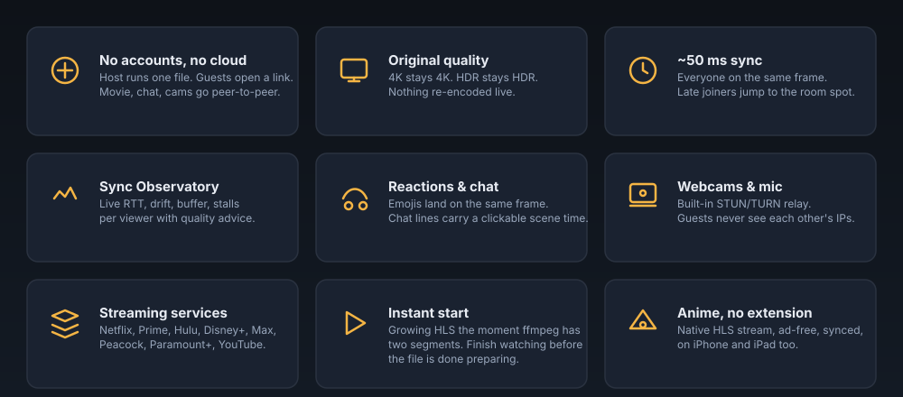
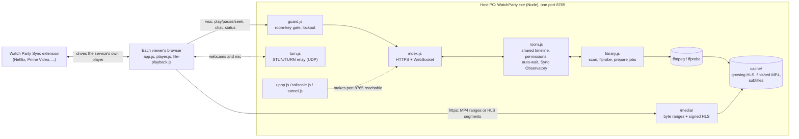
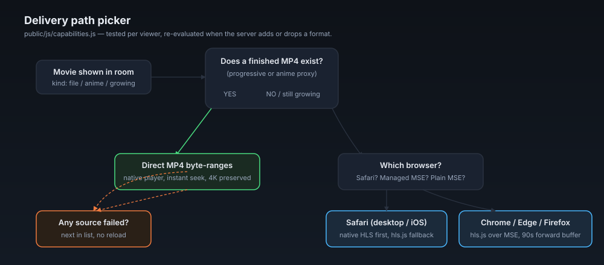
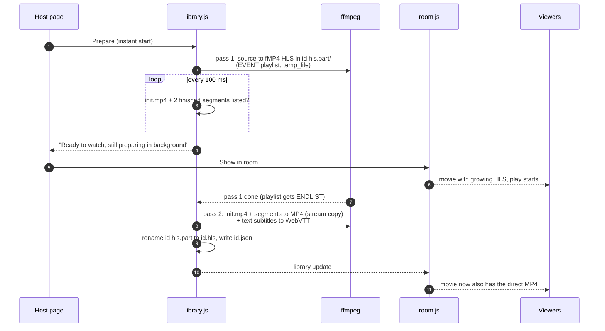
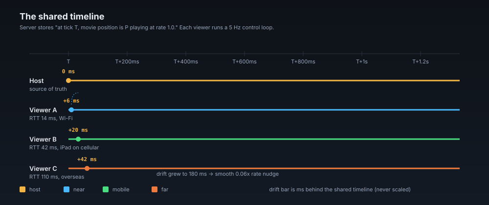
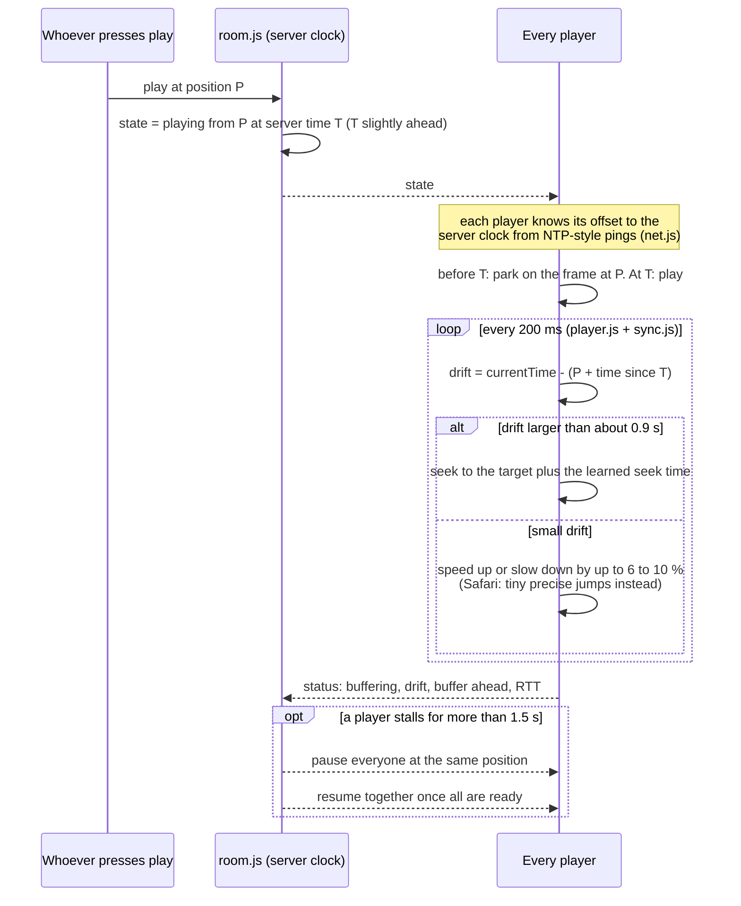
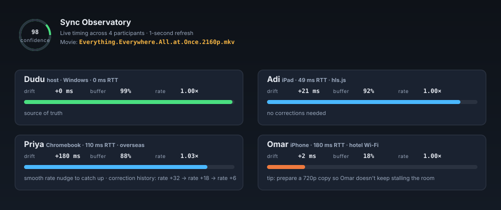
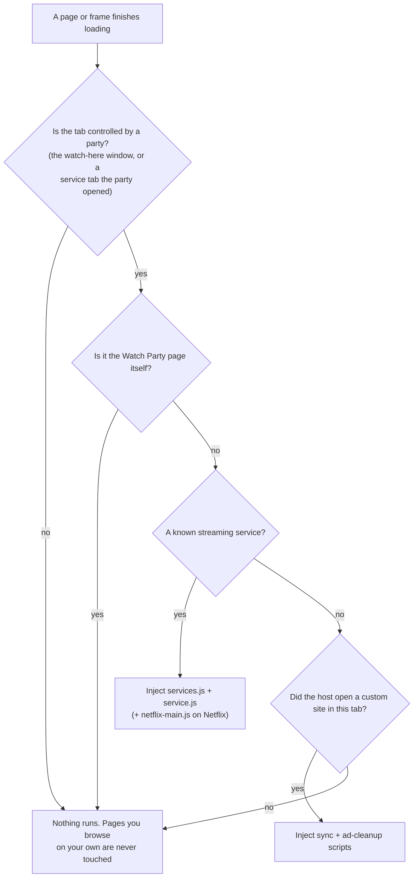
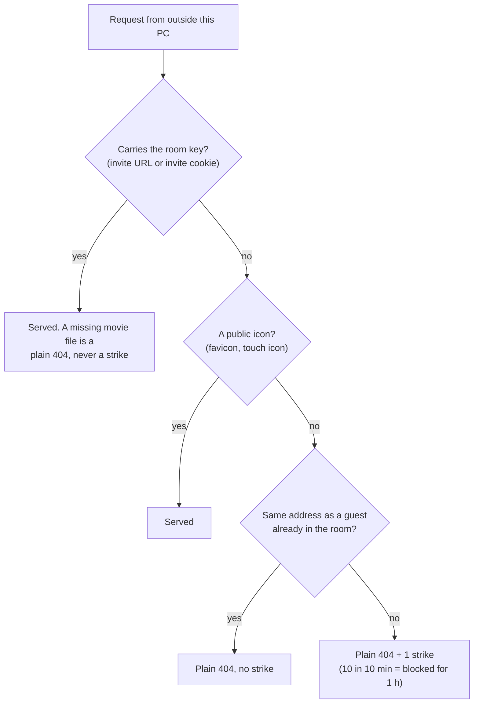

<div align="center">

# 🎬 Watch Party

**Watch movies from your PC together with friends across the world. One shared frame. Full source quality. No accounts. No cloud.**



<p>
  
  
  
  
  
  <a href="benchmark/README.md"></a>
  
</p>

<p>
  <a href="#quick-start-windows-release"><strong>Quick start →</strong></a> ·
  <a href="#features">Features</a> ·
  <a href="#how-it-works">How it works</a> ·
  <a href="#security-model">Security</a> ·
  <a href="#hosting-a-watch-party">Hosting</a>
</p>

</div>

Watch Party is a tiny self-hosted server for the host's Windows PC. Guests open an invite link in any browser; the movie streams straight from the host's disk to each guest; a shared clock keeps every player within about 50 ms. Chat, emoji reactions, webcams, scene bookmarks and streaming-service sync (Netflix, YouTube, Prime Video and friends) are built in.

### At a glance

| | | |
|:---:|:---:|:---:|
| 🎞️ **Full source quality** <br/><sub>no re-encoding, no capture</sub> | ⏱️ **~50 ms sync** <br/><sub>everyone on the same frame</sub> | 🔐 **No cloud, no accounts** <br/><sub>peer-to-peer over your WAN</sub> |
| 🎬 **Any movie file** <br/><sub>MKV, MP4, HDR, Dolby Vision</sub> | 📺 **Any streaming service** <br/><sub>Netflix, Prime, Hulu, Disney+, …</sub> | 🍥 **Anime, no extension** <br/><sub>native HLS on iPhone / iPad</sub> |
| 💬 **Chat + reactions** <br/><sub>timed to the exact movie frame</sub> | 📷 **Webcams + mic** <br/><sub>IP-hiding TURN relay built in</sub> | ⚡ **Instant start** <br/><sub>watch while the file is still preparing</sub> |

---

## Table of contents

- [Features](#features)
- [Quick start (Windows release)](#quick-start-windows-release)
- [Running from source](#running-from-source)
- [Building `WatchParty.exe`](#building-watchpartyexe)
- [How it works](#how-it-works)
- [Security model](#security-model)
- [Network setup](#network-setup)
- [Streaming services (Netflix, YouTube, …)](#streaming-services-netflix-youtube-)
- [Hosting a watch party](#hosting-a-watch-party)
- [Configuration (`config.json`)](#configuration-configjson)
- [Project structure](#project-structure)
- [Troubleshooting](#troubleshooting)
- [Limitations](#limitations)
- [Credits and license](#credits-and-license)

---

## Features

<p align="center"></p>

### What makes it different

- **Nothing to install for guests, no accounts for anyone.** Guests open a link in their browser. The host double-clicks one file.
- **No outside services.** Guests connect straight to the host's PC over an encrypted link. The movie, chat, reactions and webcams all go between the host's PC and the guests.
- **Original quality.** Each viewer's browser plays the actual movie file, so 4K stays 4K and the sound always matches the picture. Nothing is screen-captured or re-encoded live.
- **Tight sync.** Everyone stays within about 50 ms, late joiners included. If one viewer falls behind, the room pauses until they catch up.
- **Reproducible sync benchmark.** The checked-in p50/p95 badge is generated from the real adaptive tuning policy under deterministic desktop, Wi-Fi, iPad, mobile, jitter, buffer, and stall profiles; [`benchmark/README.md`](benchmark/README.md) documents the limits.
- **Sync Observatory.** The host sees every participant's RTT, drift, buffer health, bounded correction history, stall/recovery timeline, a room confidence score, and actionable quality recommendations.
- **Shared moments.** Reactions are scheduled for the same movie timestamp, chat carries a clickable scene time, and controllers can save named scene bookmarks that appear on the seek bar.
- **Adaptive theater visuals.** Host-owned movies can tint the player edges from tiny local frame samples; no frame or color telemetry leaves the browser. Reduced-motion, data-saver, low-memory, low-battery, and manual battery-saver modes automatically remove costly effects. QR invitations animate only when a guest actually reaches the room.
- **Installable PWA shell.** Install the room on a phone, tablet, or desktop for standalone chat, room controls, reactions, and the manual-sync clock. Only static UI code is cached; invite pages, keys, messages, metrics, and media stay network-only.
- **Host control.** The host approves each guest and decides per person who can play/pause/seek, chat, react, and use a camera and mic.
- **Instant start.** A movie that needs preparing becomes watchable a few seconds after **Prepare** starts. One `ffmpeg` pass writes a growing, authenticated HLS stream straight from the source; the room can press play after the first two finished segments while the rest is prepared in the background.
- **Capability-aware delivery.** Each viewer gets the best path their browser can play: byte-range MP4 for finished movies, Safari's native HLS on Mac/iPhone/iPad, and [hls.js](https://github.com/video-dev/hls.js) everywhere else. A source that fails or stalls on start falls back to the next one without reloading the page.
- **Movie library.** Watch Party scans your folders, checks each file with `ffprobe`, and offers one-click **Prepare** (repackage, fix audio, strip Dolby Vision, compress, extract subtitles, instant-start stream) with `ffmpeg`. Short tags such as **MKV** or **Dolby Vision** explain why a file needs work; click one for the details.
- **Streaming services.** Syncs Netflix, Prime Video, Hulu, Peacock, Crunchyroll, Paramount+, Max, Disney+, Apple TV+ and YouTube. Everyone plays from their own account and Watch Party keeps you together.
- **Anime, no extension.** Search by title and play an episode right in the page on any device, iPad and iPhone included. Watch Party resolves a real HLS stream and proxies it through the host, so it is synced exactly like a movie, carries subtitles and intro/outro skips, and shows no ads. If a stream can't be resolved it falls back to an embedded player.
- **Webcams and mic.** A built-in TURN relay runs on the host PC, so guests never learn each other's IP addresses. Camera tiles can be moved and resized over the movie.
- **Works with awkward networks.** Automatic UPnP port opening, Tailscale (private sharing, real HTTPS certificates, or a public Funnel link), or a Cloudflare tunnel as a last resort.
- **Phones and tablets supported** for your own movies and YouTube; the signed Safari Web Extension also supports streaming-service sync on iPhone and iPad.
- **Native Apple companion.** The optional Swift package adds AVPlayer HLS playback, Picture in Picture, AirPlay and SharePlay handoff while retaining Safari for DRM services.

---

## Quick start (Windows release)

> Use this if you just want to host a party. To work on the code, see [Running from source](#running-from-source).

1. **Download** the latest release zip from the [Releases](https://github.com/adityamehta98/watch-party/releases) page and extract it anywhere (for example `D:\watch-party`). It contains:
   ```
   WatchParty.exe           the whole app (Node + server + web page in one file)
   refresh.bat              starts Watch Party (installs an update first, if one is waiting in _update)
   bin\                     ffmpeg.exe, ffprobe.exe and their DLLs
   extension\               the Watch Party Sync browser extension
   README.md
   ```
2. **Set your home network to Private:** Start → Settings → Network & internet → Wi-Fi (or Ethernet) → your network → **Network profile type: Private**.
3. **Double-click `refresh.bat`** (or `WatchParty.exe`). You'll see two one-time prompts:
   - *"Windows protected your PC"*: click **More info**, then **Run anyway** (the app is unsigned).
   - *"Windows Defender Firewall has blocked some features"*: tick **Private networks** only, then **Allow**.
4. Your browser opens the **host page**. In **Library**, add the folders that hold your movies.
5. Open the **Room** tab and check **Your connection**. A green dot means you're ready. A red dot means you need one router change (see [Network setup](#network-setup)).
6. **Library → Show in room** on a movie, then **Invite → Copy invite message** and send it to your friends.

Watch Party runs in the background with no window. Closing the host page stops it a few seconds later. Double-clicking `WatchParty.exe` while it's running just reopens the page. Log output goes to `cache\watchparty.log`.

---

## Running from source

### Requirements

| Tool | Version | Notes |
|---|---|---|
| [Node.js](https://nodejs.org/) | 18.17 or newer (22 LTS recommended) | Runs the server |
| [ffmpeg + ffprobe](https://ffmpeg.org/download.html) | Recent build | Needed to read and prepare movies |
| Chrome / Edge / Brave | Recent | Host page and the optional extension |
| Safari | 15+ | Web app; signed Safari Web Extension required for streaming services |
| Xcode on macOS | Recent | Optional: local Safari simulator/device development; App Store Connect can package the ZIP |
| Tailscale | Optional | Only for apartments, CGNAT or trusted HTTPS |

### Steps

```bash
git clone https://github.com/adityamehta98/watch-party.git
cd watch-party
npm install
npm start
```

`npm start` runs `node server/index.js`. On first start it:

1. creates `config.json` with defaults and a random `adminKey`,
2. creates a self-signed HTTPS certificate in `cache/`,
3. tries to open port **8765** on your router via UPnP,
4. opens `http://127.0.0.1:8765/host/<adminKey>` in your browser.

### Where ffmpeg is found

The server looks for `ffmpeg` / `ffprobe` (and optional `cloudflared`) in this order:

1. `bin/` next to the app (`bin\ffmpeg.exe` on Windows),
2. on Windows: the WinGet links folder, `C:\Program Files\ffmpeg\bin`, `C:\ffmpeg\bin`,
3. anything on your `PATH` (`where` / `which`),
4. on Windows: WinGet package folders.

The quickest Windows install is `winget install Gyan.FFmpeg`. On macOS use `brew install ffmpeg`, on Debian/Ubuntu `sudo apt install ffmpeg`.

> **Platform note:** the packaged app and the setup instructions target Windows. The server is plain Node and should start on macOS and Linux too, but Windows-only bits (message boxes, the `.bat` launcher, firewall prompts) won't apply there.

---

## Building `WatchParty.exe`

The Windows build packs Node, the bundled server and every file in `public/` into one executable with [Node Single Executable Applications (SEA)](https://nodejs.org/api/single-executable-applications.html).

### Extra build tools

`esbuild` and `postject` are dev dependencies, so `npm install` already fetched them. You also need:

- a **Windows `node.exe` of the exact same version** as the Node running the build,
- a folder with **Windows ffmpeg binaries** (`ffmpeg.exe`, `ffprobe.exe`, DLLs; for example a "shared" build from [gyan.dev](https://www.gyan.dev/ffmpeg/builds/) or [BtbN](https://github.com/BtbN/FFmpeg-Builds/releases)),
- optionally `osslsigncode` (strips Node's original signature, which becomes invalid after injection).

### Build

On Windows, double-click `build.bat`. It installs the npm packages, caches a matching Windows `node.exe` and an ffmpeg "shared" build under `build\cache\` (reused on later builds), and then runs:

```bash
node build/build-windows.js /path/to/windows/node.exe /path/to/ffmpeg/bin
```

(you can also run that line directly if you already have both.) The output goes to `dist/WatchParty/`. What the script does:

1. **Bundles** `server/index.js` and its dependencies into one CommonJS file with esbuild.
2. **Checks** that the Chromium and Safari manifests match `REQUIRED_EXT_VERSION` in `public/js/media.js`, and fails if they differ.
3. **Packages both extensions** to `public/ext/watch-party-sync.zip` and `public/ext/watch-party-safari-source.zip`, then copies the Chromium folder to `dist/WatchParty/extension/`.
4. **Embeds** every file under `public/` as a SEA asset, plus the hls.js player from `node_modules` (served as `/vendor/hls.min.js`).
5. **Injects** the blob into a copy of `node.exe` with `postject`.
6. **Switches the PE subsystem** from console to GUI so the app runs without a console window.
7. **Copies** ffmpeg, ffprobe, their DLLs, the ffmpeg license and this README into `dist/WatchParty/`.

Put `refresh.bat` next to the exe, zip the `dist/WatchParty` folder and attach it to a GitHub release.

Build the extension downloads alone with `npm run build:extensions`. When changing the extension, bump `version` in both manifests and `REQUIRED_EXT_VERSION` in `public/js/media.js` together.

---

## How it works



The host's PC is the only server. Every viewer downloads the movie directly from it and plays it locally; the room only shares a timeline ("position P was playing at server time T"), and each player keeps itself on that timeline.

### 1. One port, one secret

Everything (web page, WebSocket, movie bytes, webcam relay) runs on **one port, 8765**: TCP for HTTPS/WebSocket and UDP for the TURN relay. Every guest URL contains a random 24-character room key (`/join/<key>`), kept in `config.json` so the invite link stays the same between starts. Requests without a valid key get a plain `404`, so the server doesn't reveal itself. The host page (`/host/<adminKey>`) only answers requests from `localhost`.

### 2. Streaming the movie

The server doesn't push video. Each guest's `<video>` element fetches the file from `/media/…` with **HTTP byte-range requests** (`server/media.js`), the same way a browser plays any large video from a website. This means:

- quality is exactly the source file (4K HDR stays 4K),
- seeking is instant, because the browser just asks for a different byte range,
- the host's **upload bandwidth** is the limit: roughly *bitrate × number of guests*.

Movies prepared with **Instant start** also have a fragmented-MP4 **HLS** copy: 4-second-or-longer segments cut on keyframes. HLS is what lets a movie play while it is still being prepared, and it recovers better on Apple devices. The server rewrites every playlist entry to carry the room key, accepts only `index.m3u8`, `init.mp4` and `seg-NNNNN.m4s` names, and serves playlists with `no-cache` so a growing playlist is re-read.

Each viewer picks a source with `public/js/capabilities.js`, and `public/js/file-playback.js` attaches it to the one `<video>` the sync engine controls:

<p align="center"></p>

- **Why hls.js on Chrome?** Recent Chrome versions report native HLS support, but Chrome's built-in player gives up on a playlist that is still growing (`DEMUXER_ERROR_COULD_NOT_PARSE`). Only Safari's native player is trusted; everything else uses hls.js (vendored, served from `/vendor/hls.min.js`) with a VOD-style configuration and a large forward buffer for 4K files.
- **Formats can change mid-movie.** When the finished MP4 appears, the server re-broadcasts the movie. Viewers who are already playing keep their working HLS source (`reconcileDeliverySources`); anyone who joins later gets the ranged MP4.

### 3. Preparing files for browsers

Browsers can't play every container or codec. `server/library.js` runs `ffprobe` on each file and decides whether it can play as-is. If not, **Prepare** runs an `ffmpeg` job that, depending on the file:

- **remuxes** (MKV → MP4, no re-encode, no quality loss),
- **converts audio** (for example DTS/TrueHD/AC-3 → AAC),
- **strips Dolby Vision** metadata (fixes the "sound but black screen" problem),
- **extracts text subtitles** to WebVTT (or picks up a matching `.srt` next to the movie),
- optionally **compresses for streaming** (about 20 to 25 Mbps), using a hardware encoder when one works (and falls back to the CPU encoder if the graphics card can't handle the file).
- with **Instant start** (on by default), builds the HLS stream first so the movie is watchable within seconds.

**Instant start, step by step.** The old pipeline wrote a complete MP4 and then read that multi-gigabyte file a second time to cut HLS, so nobody could watch until both passes finished. Now the expensive pass writes the stream directly from the source, and the browser MP4 is a cheap stream copy at the end:



Details that make this safe:

- **No half-written segments.** The playlist is an HLS `EVENT` playlist written with `temp_file`, so a segment only appears in it once ffmpeg has finished writing it. While the job runs, only the job's own `*.hls.part` folder is served; a failed or cancelled job is never treated as a prepared copy.
- **Apple-friendly HEVC.** Stream-copied HEVC is tagged `hvc1` and gets its parameter sets rebuilt (`hevc_mp4toannexb,extract_extradata`), without which iOS can wait forever on the first frame. Dolby Vision RPUs are stripped with `dovi_rpu` when the bundled ffmpeg has it; otherwise the video is re-encoded.
- **Audio stays on the video clock.** Audio the browser can't play is re-encoded to AAC (Windows' `aac_mf` encoder when it works, ffmpeg's `aac` otherwise) through `aresample=async=1`, which fills or trims tiny gaps so long movies don't drift.
- **The MP4 copy reads the fragments as one file.** Pass 2 opens `init.mp4` and the segments in order through ffmpeg's `concatf:` protocol. Reading them through ffmpeg's HLS demuxer instead started the finished MP4's audio about 10 seconds late.

Prepared copies go in `cache/` and are deleted when the app stops, unless `keepPrepared` is `true`.

### 4. Keeping everyone in sync

- **Clock sync** (`public/js/net.js`): every client keeps measuring the offset between its clock and the server's over the WebSocket, NTP-style.
- **Shared timeline** (`server/room.js`): the room stores *"position P was playing at server time T, at rate 1.0"* (or *paused at P*). Play, pause and seek update that state and broadcast it, with a short start delay so every player starts on the same tick.
- **Adaptive drift correction** (`public/js/player.js`, `public/js/sync.js`): each player compares its `currentTime` with the shared timeline. An RTT-aware deadband and smoothed drift prevent oscillation; low-buffer players avoid aggressive speed-ups and repeated seeks. Large drift still triggers a decisive seek. Late joiners compute the current room position and jump there.
- **Buffering:** if a viewer stalls for more than 1.5 s, the room pauses everyone at the same position and resumes together 0.7 s after all players report ready (or after 30 s). Someone who stalls 3 times in 4 minutes stops pausing the room for 15 minutes and catches up on their own; the host is told why.

<p align="center"></p>

<details>
<summary><b>Sequence diagram: play → sync → stall → resume</b></summary>



</details>

- **Sync Observatory:** the Room's **Sync** tab renders live RTT rings, drift, buffer health, recent correction decisions, synchronization confidence, stall/recovery markers, and suggestions such as preparing a 720p copy for a struggling guest. These numbers change every second, so they travel in their own host-only `observatory` message; the people list is only re-sent (to the host and guests separately) when it actually changes. Telemetry is bounded in memory, resets with the movie, and is never written to disk.

<p align="center"></p>
- **Shared moments:** the server timestamps reactions slightly ahead so every synced screen animates them on the same movie frame. Chat messages carry their movie position, and scene bookmarks are bounded to the current title. These moment records stay in room memory and are never written to configuration or disk.
- **Adaptive visuals:** ambient theater colors come from a 12×7 local sample of host-owned video at most a few times per second; samples are neither transmitted nor stored. Effects stop in background tabs and are disabled for reduced-motion, data-saver, low-memory, low-battery, or manual battery-saver modes. Sidebar and QR handoff motion uses only compositor-friendly transforms and opacity.

### 5. Webcams and mic

`public/js/rtc.js` builds a small WebRTC mesh (fine for a handful of people). By default, media goes through **Watch Party's own STUN/TURN server** (`server/turn.js`, RFC 5389/5766, UDP only) on the host PC with credentials that change every run. Guests never connect to each other directly, so nobody learns anyone else's IP address. `webcamMode` can switch to direct peer-to-peer when needed (for example over a TCP-only public link).

### 6. Reaching the host from the internet

In order of preference:

| Method | File | When |
|---|---|---|
| **UPnP** | `server/upnp.js` | Router supports it. The app opens the port at start and closes it at exit. |
| **Manual port forward** | – | Port 8765 TCP + UDP to the host PC |
| **Tailscale** | `server/tailscale.js` | Apartments or CGNAT. Private sharing, a trusted `*.ts.net` HTTPS cert, or a public **Funnel** link |
| **Cloudflare quick tunnel** | `server/tunnel.js` | Last resort, if `cloudflared` is in `bin/`. No webcams. |

Without Tailscale certificates, `server/cert.js` creates a **self-signed certificate** using only Node's built-in crypto. Browsers allow camera and mic only on HTTPS pages, so guests click past a one-time "not private" warning.

### 7. Streaming services

For Netflix and similar services the video can't be shared, because DRM blacks out captured or relayed video. Instead, everyone plays the title **on their own account**, and the **Watch Party Sync** extension (Manifest V3) drives each person's player:

- `extension/service.js` runs on the streaming site, finds the main `<video>`, reports its position, and applies play/pause/seek commands. Your own clicks in the player are shared with the room.
- `extension/netflix-main.js` runs in Netflix's page context and uses Netflix's own player API, because setting `currentTime` directly triggers an error there.
- `extension/party.js` relays messages between the Watch Party page and the extension. `background.js` connects the two tabs and decides where the sync scripts run. Only `party.js` (on Watch Party pages) still comes from the manifest; the service scripts are added on demand, and only to tabs a party controls:


- `sidebar.*` and `theater.*` show the party (chat, cameras, controls) in Chrome's side panel or in a combined "watch here" window.
- `apple/SafariWebExtension/` overlays a Safari popup manifest on the same extension code. Safari uses a normal top-level player tab, avoiding embedded-player sandbox detection on iPhone and iPad.
- On the web page, `public/js/media.js` wraps the remote player (and the YouTube IFrame player) in an adapter that behaves like a `<video>` element, so the same sync engine drives all of them.

**YouTube** needs no extension: `server/youtube.js` searches youtube.com without an API key, and the video plays in the embedded YouTube player for everyone, phones included.

---

## Security model

Watch Party opens **one port (8765)**, and only while the app is running.

- **Invisible without the link.** Requests without the secret key get a plain `404` for everything. The key is 24 random characters (about 140 bits).
- **New link every run.** The invite key changes each time the app starts. **New link** in the Room tab rotates it instantly and disconnects everyone.
- **Brute-force lockout** (`server/guard.js`). An IP with 10 wrong attempts in 10 minutes is blocked for an hour. There are also per-IP connection limits and idle-connection timeouts. Only real guesses count as attempts; requests that phones and browsers make on their own never lock a guest out:


- **Host approval.** You can require approval for each guest. **People** shows each guest's IP so you can spot strangers. **Lock room** stops new joins.
- **Host-only admin.** The host page, library and settings answer only on `localhost`, even with the admin key.
- **Encrypted.** Guests always use HTTPS. Plain HTTP from the internet is only redirected to HTTPS.
- **Read-only for guests.** Guests can stream only the movie currently shown. They can't browse files and can't upload anything.
- **IP privacy.** Webcam traffic is relayed through the host, so guests don't learn each other's addresses. The relay forwards only between party members and never to arbitrary internet hosts.
- **Clean shutdown.** When the app stops it removes the UPnP mapping and turns off any public link.

**Honest limits:** no software is unbreakable. These measures reduce the exposure to one small app that answers only people holding a key that changes every run. The self-signed certificate means guests see a one-time browser warning (the connection is still encrypted). Use Tailscale HTTPS to avoid it.

> **Don't commit `config.json` or `cache/`.** They contain your admin key, TLS private keys and local paths. Both are listed in `.gitignore`.

---

## Network setup

### Green dot in the Room tab
The router opened the port automatically. You're done.

### Red dot: one-time router change
Open your router's admin page (often `192.168.0.1` or `192.168.1.1`, or your ISP's app), then do one of these:

- **Option A (easiest):** turn on **UPnP**, then click **Try router again** in the Room tab.
- **Option B:** add a **port forward**: port **8765**, protocol **TCP and UDP**, to this PC's local IP (shown in the Room tab). Then enter your public IP under **Public address** (or click **Look up**).
- **Don't use DMZ.** It exposes your whole PC.

### Apartments and student housing (no router access)
Use **[Tailscale](https://tailscale.com/)** (free):

1. Install Tailscale on the host PC and sign in.
2. In the Tailscale admin console go to **Machines** → **…** next to your PC → **Share**, and send the share link to each friend.
3. Each friend installs Tailscale and accepts the share (once). Watch Party switches the invite link to your `100.x.x.x` address automatically.

- **No certificate warning:** in the Tailscale admin console go to **DNS → HTTPS Certificates → Enable HTTPS**, then restart Watch Party. The invite becomes `https://your-pc.your-tailnet.ts.net:8765/…` with a trusted certificate.
- **Link for anyone, no Tailscale for guests:** turn on **Room → Public link for anyone** (Tailscale Funnel). Webcams don't work over it (TCP only) and speed is limited, so use a "Compress for streaming" copy.
- Watch Party connects Tailscale on this PC when it starts (opening the Tailscale app if needed) and disconnects it when it stops, so the public link is ready from the start.

### Provider shares IP addresses (CGNAT: T-Mobile Home Internet, Starlink, …)
Direct connections can't work. Use Tailscale as above, or as a last resort put `cloudflared.exe` in `bin/` and set `"tunnel": "cloudflare"` in `config.json` (no webcams).

---

## Streaming services (Netflix, YouTube, …)

In **Library → Watch together on a streaming service**, click a service.

- **YouTube** plays inside the Watch Party page for everyone, phones included. No sign-in or extension needed.
- **Netflix, Prime Video, Hulu, Peacock, Crunchyroll, Paramount+, Max, Disney+, Apple TV+** need the free **Watch Party Sync** extension, installed once by everyone watching:
  1. Host: use the `extension/` folder. Guests: click **Download the extension** on their party page and unzip it.
  2. Open `chrome://extensions` (Edge: `edge://extensions`, Brave: `brave://extensions`) and turn on **Developer mode**.
  3. Click **Load unpacked** and choose the folder.
  4. Reload the Watch Party page and click a service tile.

Safari installation is selected automatically by device:

- **iPhone/iPad:** the host adds the signed TestFlight or App Store link under **Room → Apple devices**. Guests install it, enable **Settings → Apps → Safari → Extensions → Watch Party Sync**, grant site access, and reload the party in Safari.
- **Mac Safari:** install the signed app, or download the Safari source and package it as documented in [`apple/README.md`](apple/README.md).
- Apple does not allow an installable iPad extension ZIP. Use Apple's App Store Connect web packager (no Mac required) or Xcode, then distribute the containing app through TestFlight/App Store.

How it behaves:

- Everyone signs in with **their own** account. When the host (or anyone with playback control) presses play, everyone's tab jumps to the same title and position. Episode changes follow too.
- The service's own play/pause/seek controls are shared with the room.
- **Skip Intro / Skip Recap / Skip Credits / Next Episode** are pressed automatically in the host's window, and everyone follows. You can turn this off under the service tiles.
- **Ads:** when one person gets an ad, the room waits for them.
- **Android:** streaming services use the live manual-sync clock because Android browsers do not support this Safari/Chromium extension.
- **iPhone/iPad:** Safari uses the signed Web Extension. Until it is published, the party shows installation/publishing guidance instead of handing the streaming URL to a native app.
- **Home-screen app:** tap **Install** (Chromium) or **Share → Add to Home Screen** (Safari). The installed shell keeps chat, reactions, controls, and manual sync together in a standalone window; DRM playback still opens in the streaming service's Safari tab.
- **Brave + Netflix "Something went wrong":** turn Shields off for netflix.com.
- **After each Watch Party update**, reload the extension at `chrome://extensions`. The party page tells you when it's out of date.
- The extension's sync script only runs in tabs a Watch Party is using: the "watch here" window, a service tab the party opened, and a custom site the host opened. Nothing runs on pages you open yourself. It only moves play, pause, seek and volume, and never sees passwords, accounts or the video stream.

### Custom site (any website with a video)

In **Library → Watch together on a streaming service → Custom site**, the host pastes the link of any page with a video and clicks **Open for everyone**.

- Chromium opens the page inside the Watch Party theater window. Safari opens it as a normal top-level tab, which avoids iframe/sandbox checks on iPhone and iPad.
- **Only the host controls it.** When the host presses play, pause or skips in the site's own player, everyone follows. A guest's clicks are undone and their player follows the host. Guests with playback control lose it while a custom site is on.
- When the host moves to another page on the site (the next episode, say) and plays it, everyone's window follows.
- Players that sit in a frame inside the page (common on video sites) work too.
- **Ad pop-ups and pop-unders are blocked (on by default):** cross-site tabs opened by the custom site or its player frames are closed at once and focus returns to the Watch Party. Same-site buttons and navigation still work. This does not add an iframe sandbox, so players cannot reject playback with a “Sandbox detected” error.
- **Built-in ad blocker (always on for custom sites, nowhere else):** ad and pop-up networks are blocked (`extension/ad-domains.js`), pop-up and pop-under tabs are closed the moment they open, invisible click-catching layers over the video and the page are removed, and links that would take over the whole window stay inside the site's box. The video and the site's own buttons keep working.
- Everyone watching needs the extension. If a video doesn't start by itself, click play once inside it. On Chromium, a site may still refuse the combined theater layout; Safari's top-level-tab path avoids that limitation.

---

## Hosting a watch party

1. Double-click **refresh.bat** (or **WatchParty.exe**).
2. **Library → Show in room** on a movie. Press **Prepare** first if it says **Needs prep**.
3. **Invite → Copy invite message with instructions** and send it.
4. Approve each guest in the **Let in / Deny** pop-up.
5. Optionally click **Lock room** in **People** once everyone is in.
6. Press play. Late arrivals jump to the right spot automatically.
7. Close the Watch Party tab when you're done. A few seconds later the app stops, the port closes and the link stops working.

**Letting others pick:** anyone with playback control also gets the **Library** tab. They can show your movies, start **Prepare**, search YouTube or pick a streaming service. They can't see folder names, change folders or delete prepared copies.

**Keyboard:** `Space` play/pause · `←`/`→` back/forward 10 s (tap repeatedly to jump further) · `↑`/`↓` volume · `M` mute · `F` fullscreen · `Enter` chat
**Swipes:** swipe right or left on the picture (or two fingers sideways on a trackpad) to skip ±20 s.

### What guests need
- **Chrome on a computer** is best for 4K HEVC, with **Settings → System → Use graphics acceleration** on. Edge and Safari work too. Firefox may not play HEVC.
- **Headphones** if their mic is on, to avoid echo.
- If a guest hears sound but sees no picture, **People** shows "Sound only" next to them. Fix it with Chrome + hardware acceleration, or a **Compress for streaming** copy.

### Quality and bandwidth
Each guest downloads the movie from you while watching, so your **upload** speed is the limit (bitrate × viewers). Enter it in **Room → Home upload speed** to get warnings. For heavy files use **Options → Compress for streaming**.

### Subtitles
Text subtitles inside MKVs are extracted during **Prepare**. A same-named `.srt` next to the movie also works. Blu-ray image subtitles (PGS) can't be shown in browsers. Each viewer toggles subtitles with **CC**.

---

## Configuration (`config.json`)

Created automatically on first run, next to `WatchParty.exe` (or in the repo root when running from source). Most settings can also be changed from the host page. See [`config.example.json`](config.example.json). Delete `config.json` to reset everything.

| Key | Default | Description |
|---|---|---|
| `port` | `8765` | The single port: TCP for web/WebSocket/media, UDP for the webcam relay |
| `bind` | `"0.0.0.0"` | Interface to listen on |
| `folders` | `[]` | Movie folders to scan |
| `cacheDir` | `"cache"` | Where prepared copies, certs and logs go. Point it at a big drive if needed. |
| `keepPrepared` | `false` | Keep prepared copies after the app stops |
| `safariExtensionUrl` | `""` | Signed `apps.apple.com` or `testflight.apple.com` install link shown to Safari guests |
| `linkMode` | `"secure"` | `"secure"` = HTTPS (webcams work). `"plain"` = HTTP (no warning, no webcams). |
| `upnp` | `true` | Ask the router to open the port automatically |
| `publicHost` | `""` | Your public IP or hostname if you forward the port yourself |
| `publicUrl` | `""` | Full override of the invite base URL (for example your own domain) |
| `publicLink` | `false` | Tailscale Funnel public link (TCP only) |
| `tunnel` | `"none"` | `"cloudflare"` to use `bin/cloudflared` (last resort) |
| `uploadMbps` | `0` | Your home upload speed, used for bitrate warnings |
| `maxChunkMB` | `32` | Max size of one media response chunk |
| `webcamMode` | `"auto"` | `"relay"` (via host only), `"direct"` (peer-to-peer), `"auto"` (direct when the public link is on, relay otherwise) |
| `extraIceServers` | `[]` | Extra STUN/TURN servers for WebRTC |
| `cloudflareTurn` | `null` | Optional `{ "keyId", "token" }` for Cloudflare Realtime TURN |
| `room.autoWait` | `true` | Pause the room while someone buffers |
| `room.requireApproval` | `false` | Ask the host before letting each guest in |
| `room.maxGuests` | `4` | Maximum number of guests |
| `room.defaults` | all `true` | Default permissions for new guests: `playback`, `chat`, `react`, `camera` |
| `adminKey` | *(generated)* | Secret for the host page URL. **Keep private.** |
| `roomKey` | *(generated)* | The secret in the invite link (`/join/<roomKey>`). Stays the same between starts, so your invite link doesn't change; **Room → Make a new invite link** replaces it. |

---

## Project structure

```
watch-party/
├── server/                 Node backend
│   ├── index.js            entry point: config, HTTP(S) + WebSocket server, routing, startup/shutdown
│   ├── room.js             room state, guests, permissions, shared playback timeline
│   ├── library.js          folder scanning, ffprobe analysis, ffmpeg "prepare" jobs
│   ├── media.js            HTTP byte-range file serving
│   ├── guard.js            secret-key gate, brute-force lockout, connection limits
│   ├── cert.js             self-signed HTTPS certificate (built-in crypto only)
│   ├── turn.js             built-in STUN/TURN server for webcams (UDP)
│   ├── upnp.js             UPnP IGD port mapping (SSDP + SOAP)
│   ├── tailscale.js        Tailscale address, HTTPS certs, Funnel
│   ├── tunnel.js           Cloudflare quick tunnel (optional)
│   ├── youtube.js          key-less YouTube search
│   ├── services.js         list of supported streaming services
│   ├── tools.js            locate ffmpeg/ffprobe/cloudflared, detect hardware video and AAC encoders
│   ├── settings.js         config.json migration and validation
│   ├── pwa.js              install manifest for the home-screen app
│   └── assets.js           serve web files (and the vendored hls.js) from disk or from inside the exe
├── public/                 web client (host page and guest page)
│   ├── index.html
│   ├── css/app.css
│   ├── js/app.js           UI: library, room, people, chat, reactions, invite
│   ├── js/net.js           WebSocket with auto-reconnect and server clock sync
│   ├── js/player.js        drift correction against the shared timeline
│   ├── js/sync.js          pure adaptive sync tuning rules
│   ├── js/capabilities.js  playback detection and delivery-source selection
│   ├── js/file-playback.js attaches direct MP4, native HLS or hls.js to the shared <video>, with fallback
│   ├── js/media.js         YouTube and remote-tab (extension) player adapters
│   ├── js/rtc.js           WebRTC webcam/mic mesh
│   └── ext/                built extension zip for guests (generated)
├── extension/              shared "Watch Party Sync" Web Extension source (MV3)
├── apple/                  Safari overlay, secure release guide and native WatchPartyKit
├── build/build-windows.js  builds dist/WatchParty/WatchParty.exe (Node SEA)
├── bin/                    ffmpeg/ffprobe binaries (not committed; see bin/README.txt)
├── refresh.bat             Windows launcher: installs a waiting update (from _update\), then starts Watch Party
├── build.bat               Windows build: rebuilds dist\WatchParty\WatchParty.exe from this source tree
├── config.example.json     sample configuration
└── package.json
```

Runtime dependencies are just [`ws`](https://github.com/websockets/ws) (WebSocket), [`qrcode`](https://github.com/soldair/node-qrcode) (QR code for invite links) and [`hls.js`](https://github.com/video-dev/hls.js) (HLS playback in browsers without a usable native player). Everything else (TLS certificates, UPnP, TURN, range serving) is written with Node's standard library.

---

## Troubleshooting

| Problem | Fix |
|---|---|
| Friends get **"can't reach this page"** | Check the Room tab. If you missed the firewall prompt: Start → *Allow an app through Windows Firewall* → WatchParty → tick **Private**. Make sure the network profile is Private. |
| A friend gets **"Not found"** | They have an old link. Links change every run, so send the current one. |
| A friend is **blocked** after mistyping | Room tab → **Unblock all**. |
| **Black screen with sound** | Dolby Vision file: **Prepare** it again. Otherwise the guest should use Chrome with graphics acceleration on, or use a compressed copy. |
| Someone **keeps buffering** | Your upload or their download is too slow for the file. Use **Compress for streaming**. |
| **Sound is seconds behind the picture**, or a movie only plays once **Prepare** has finished | The copy was made by an older version. **Prepare** it again. |
| **No sound** for a guest | They click the orange **Tap to turn sound on** button (browser autoplay rules). |
| **Port 8765 is in use** | Close the other program, or change `"port"` in `config.json`. |
| Closed the host tab by accident | Double-click `WatchParty.exe` again within a few seconds and the page reopens. |
| Streaming service stopped syncing | Reload the extension at `chrome://extensions`. Sites change their players, so the extension may need an update. |
| Need logs | `cache/watchparty.log` |

---

## Limitations

- The host's **upload speed** caps quality × number of guests.
- The webcam mesh is designed for **a handful of people** (default `maxGuests: 4`).
- Blu-ray **PGS image subtitles** aren't supported in browsers.
- **Firefox** may not play HEVC/4K files.
- Streaming-service sync depends on each site's player and **can break when a site changes**. iPhone/iPad require a signed Safari build distributed through TestFlight or the App Store; Android uses manual sync.
- Watch Party doesn't and can't re-stream DRM content. Every viewer needs their own subscription.

---

## Credits and license

- Watch Party's own code is released under the [MIT License](LICENSE).
- [FFmpeg](https://ffmpeg.org/) is a separate project under LGPL/GPL. Release builds ship its binaries in `bin/` with `FFMPEG-LICENSE.txt`. They aren't part of this repository.
- Uses [`ws`](https://github.com/websockets/ws), [`qrcode`](https://github.com/soldair/node-qrcode) and [`hls.js`](https://github.com/video-dev/hls.js) (Apache-2.0; its license ships as `/vendor/hls.LICENSE.txt`).
- Netflix, YouTube, Prime Video, Hulu, Peacock, Crunchyroll, Paramount+, Max, Disney+ and Apple TV+ are trademarks of their respective owners. This project isn't affiliated with or endorsed by any of them.

Please only share content you have the right to share.
